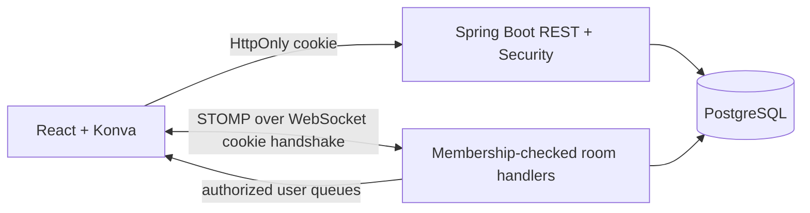

# CollabBoard — Real-Time Collaborative Whiteboard

CollabBoard is a persistent React/Konva whiteboard backed by Spring Boot, STOMP over WebSocket, and PostgreSQL. Users register with an account, create and manage their boards, and collaborate with invited board members.

## Features

- Sign up, sign in, logout, and refresh-persistent authentication using a signed JWT in an HttpOnly, SameSite=Strict cookie. Passwords are BCrypt-hashed. Forgot-password links use single-use, 30-minute reset tokens; only token hashes are stored.
- Authenticated dashboard with **My Boards**, **Shared With Me**, search, profile name, create, and join by ID or invitation URL.
- Board ownership, owner-only rename/invitation/member management, and editor access for collaborators.
- Random, expiring invitation tokens are stored as SHA-256 hashes. A link requires the recipient to sign in or create an account before it grants board membership.
- Room-level REST and WebSocket membership checks. Board events go to authenticated per-user destinations, so revoked members stop receiving future board broadcasts.
- Existing drawing tools: pen, eraser, rectangles, circles, arrows, text, sticky notes, resize/move/recolor, undo/redo, cursor presence, and PNG export.
- Flowchart mode with Start/End, Process, and Decision nodes, editable labels, draggable positioning, node deletion, and auto-positioned directed connectors.
- Kanban mode with To Do, In Progress, and Done columns, draggable tasks, editable descriptions, deletion, and assignment to authorized board members.
- Room chat with authenticated sender identity, live STOMP delivery, unread count, reconnect-aware UI, and the 50 most recent persisted messages (history requests can retrieve up to 100).
- PostgreSQL JSONB board state, Flyway migrations, row-locked versioned snapshots, and 250 ms client-side board event debounce.

The flowchart and Kanban modes store their nodes, connectors, and tasks in the same room board-state JSON as whiteboard elements. They therefore use the existing persistence and room authorization/synchronization path. Clients send element-level additions, updates, and removals; the server applies each change to the latest locked state so independent edits are retained. Concurrent changes to the same element still use last-write-wins.

## Architecture



### Structure

- `frontend/src/auth/` — cookie-authenticated API client and account state
- `frontend/src/pages/` — sign-in/sign-up, password recovery, dashboard, invite acceptance, and existing board UI
- `frontend/src/features/` — flowchart and Kanban board modes
- `frontend/src/features/RoomChat.jsx` — room chat drawer and message composer
- `frontend/src/canvas/`, `hooks/`, `services/`, `state/` — Konva canvas, STOMP room state, API client, and undo/redo
- `backend/src/main/java/com/collabboard/auth/` — user entity, registration, login, logout, current-account endpoint, and password recovery
- `backend/src/main/java/com/collabboard/security/` — signed JWT cookie filter and identity principal
- `backend/src/main/java/com/collabboard/controller/` — protected REST board endpoints
- `backend/src/main/java/com/collabboard/service/` — board persistence, ownership, membership, invite validation
- `backend/src/main/java/com/collabboard/chat/` — persisted room message entity, history, and authorized message service
- `backend/src/main/java/com/collabboard/websocket/` and `config/` — STOMP authorization, per-user messages, presence, Spring Security
- `backend/src/main/resources/db/migration/` — additive Flyway schema migrations (`V2` adds accounts/board access, `V3` adds room chat, and `V4` adds reset tokens and session invalidation)

## Prerequisites

Windows 10/11, Node.js 20+, Java 21, Maven 3.9+, and Docker Desktop with Docker Compose.

## Start locally in PowerShell

From the project root, start PostgreSQL:

```powershell
docker compose up -d postgres mailpit
```

In a second PowerShell window, start Spring Boot with the persistent JWT key setup script:

```powershell
cd backend
.\run.ps1
```

On first run, `run.ps1` creates a 48-byte cryptographically random key, stores a DPAPI-encrypted copy under the current user's LocalAppData, and exports it as `JWT_SECRET` for Spring Boot. This keeps JWT sessions valid across restarts without putting a plaintext secret in the repository. For production, provision `JWT_SECRET` through your deployment's secret manager and set `COOKIE_SECURE=true` behind HTTPS.

In a third PowerShell window:

```powershell
cd frontend
Copy-Item .env.example .env
npm install
npm run dev
```

Visit `http://localhost:5173`, create an account, then create your first board. Flyway applies the database migrations when the API starts. Local password reset emails appear in the Mailpit inbox at `http://localhost:8025`.

## Environment variables

The backend reads environment variables directly; `backend/.env.example` is a reference and is not automatically loaded by Spring Boot. `backend/run.ps1` retrieves or creates `JWT_SECRET` for local Windows startup if it is missing.

| Variable | Purpose | Local default |
|---|---|---|
| `JWT_SECRET` | HMAC signing key; at least 32 UTF-8 bytes | Generated once by `backend/run.ps1`; can be supplied through environment/secret manager |
| `JWT_TTL_MS` | Cookie token lifetime | `86400000` (24 hours) |
| `COOKIE_SECURE` | Add Secure cookie flag | `false` for local HTTP; `true` for HTTPS |
| `DATABASE_URL` | JDBC URL | `jdbc:postgresql://localhost:5433/collabboard` |
| `DATABASE_USER` | PostgreSQL role | `collabboard` |
| `DATABASE_PASSWORD` | PostgreSQL password | `collabboard` (local Compose only) |
| `SERVER_PORT` | API port | `8080` |
| `FRONTEND_ORIGIN` | Allowed browser origin for API and WebSocket | `http://localhost:5173` |
| `VITE_API_URL` | Frontend REST origin | `http://localhost:8080` |
| `VITE_WS_URL` | Frontend STOMP endpoint | `ws://localhost:8080/ws` |
| `SMTP_HOST`, `SMTP_PORT` | SMTP server and port used for reset email | `localhost:1025` (local Mailpit inbox) |
| `SMTP_USERNAME`, `SMTP_PASSWORD` | SMTP credentials | Provider credentials from environment/secret manager |
| `SMTP_AUTH`, `SMTP_STARTTLS` | SMTP authentication and STARTTLS switches | `false` for local Mailpit; set per provider in production |
| `MAIL_FROM` | Verified sender address | `collabboard@localhost` locally; use a verified address for production |
| `APP_PUBLIC_BASE_URL` | Frontend origin used to construct reset links | `http://localhost:5173` |

The committed Compose password is only for the local development database. Use secret-managed credentials outside local development.

## Authentication, boards, and sharing

The browser sends the JWT cookie automatically; JavaScript cannot read it. The UI calls `/api/auth/me` on load to restore the session. Expired sessions return the user to sign in. Sign-up checks name, email, password length, and confirmation in the browser and server. Passwords are hashed with BCrypt.

Creating a board assigns ownership to the authenticated user. Owners can rename the board, issue a share link, view its member list, and remove members. Invitation links expire after 72 hours by default, can be redeemed only while signed in, and add the account to that board as an editor. Sharing a room ID alone does not grant access: a user must already be a member or redeem a valid invite. A removed member loses REST and WebSocket access; existing invitation tokens for that board are invalidated when a member is removed.

On the login page, **Forgot password?** starts the recovery flow. Locally, the backend sends a single-use reset link valid for 30 minutes through Mailpit; open `http://localhost:8025` to retrieve it. The API returns a generic message that does not reveal whether an email belongs to an account. `backend/run.ps1` selects local Mailpit defaults when SMTP variables are blank. For production, set `SMTP_HOST`, `SMTP_PORT`, `SMTP_USERNAME`, `SMTP_PASSWORD`, `SMTP_AUTH=true`, `SMTP_STARTTLS=true`, `MAIL_FROM`, and `APP_PUBLIC_BASE_URL` in the backend environment. Never commit provider credentials. After following the link, choose a password with at least 10 characters. Resetting it invalidates existing login cookies.

`GET /api/rooms` returns only boards owned by or shared with the current account. `GET /api/rooms/{id}` and board mutations require membership. The STOMP handshake uses the same cookie, and each room subscription and send is authorized. Outgoing snapshots/cursors use `/user/queue/rooms/{roomId}` and are sent only to current owners and members.

Conflict handling uses PostgreSQL row locks and element-level changes. Independent edits are merged into the latest room state, and clients ignore older versions while preserving local changes that have not yet been acknowledged. Concurrent edits to the same element use last-write-wins; this MVP does not provide field-level conflict resolution.

Room chat uses the same authenticated STOMP connection: clients send `{ "content": "...", "clientId": "..." }` to `/app/rooms/{roomId}/chat`; the server derives the sender from the authenticated principal, validates room access and content length (1–2,000 characters), saves the message, and sends a `CHAT` event only to authorized members at `/user/queue/rooms/{roomId}`. `CHAT_ERROR` events report rejected messages. `GET /api/rooms/{roomId}/messages?limit=50` returns an authorized room’s recent message history in chronological order. The client merges history and live messages by database message ID so messages arriving during history loading are not duplicated.

### API overview

- `POST /api/auth/signup` — `{name,email,password,confirmPassword}`
- `POST /api/auth/login` — `{email,password}`; sets the HttpOnly cookie
- `POST /api/auth/password/forgot` — `{email}`; sends a reset link when SMTP is configured
- `POST /api/auth/password/reset` — `{token,password,confirmPassword}`; consumes a valid reset token
- `POST /api/auth/logout`, `GET /api/auth/me`
- `GET /api/rooms`, `POST /api/rooms`, `GET /api/rooms/{id}`
- `PATCH /api/rooms/{id}` — owner-only title update
- `POST /api/rooms/{id}/invitations` — owner-only; `{ "expiresHours": 72 }`
- `POST /api/rooms/invites/{token}/accept` — signed-in recipient redeems invite
- `GET /api/rooms/{id}/members` — authorized board members; `DELETE /api/rooms/{id}/members/{userId}` — owner-only
- `GET /api/rooms/{id}/messages?limit=50` — authorized room chat history, maximum 100
- WebSocket `/ws`; subscribe `/user/queue/rooms/{id}`; send room join, leave, board, and cursor messages to `/app/rooms/{id}/...`.
- WebSocket chat messages go to `/app/rooms/{id}/chat` and are persisted before authorized room delivery.

## Tests and production builds

```powershell
cd frontend
npm test
npm run build
cd ..\backend
mvn test
mvn package
```

Frontend tests cover auth form validation, room chat history display/composition, shared STOMP chat transport, existing board controls, and undo/redo. Backend tests cover BCrypt registration, password confirmation, chat validation and room authorization, board membership checks, invalid board elements, and REST authentication. A PostgreSQL-backed, multi-browser end-to-end chat run still needs to be performed on a machine with Docker running.

